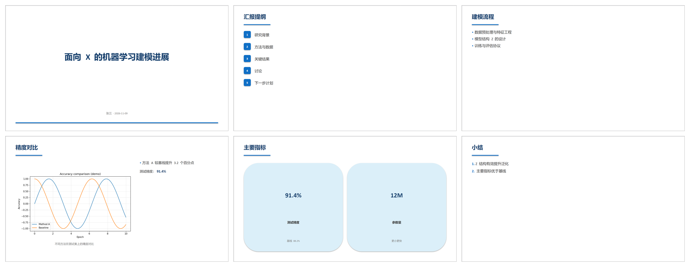
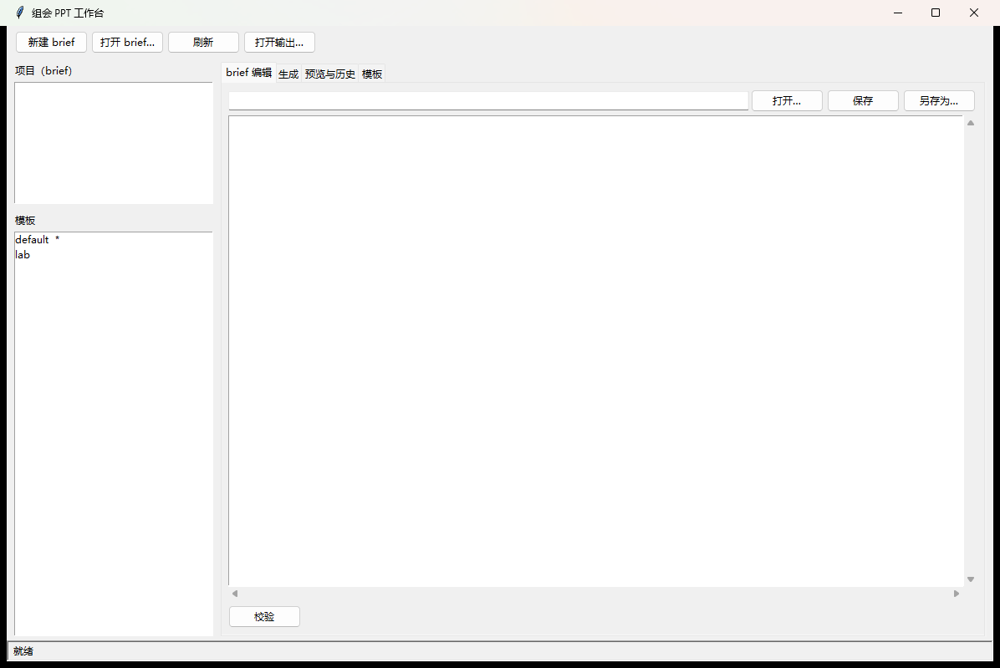
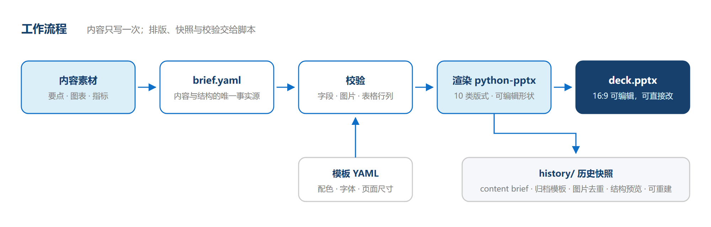
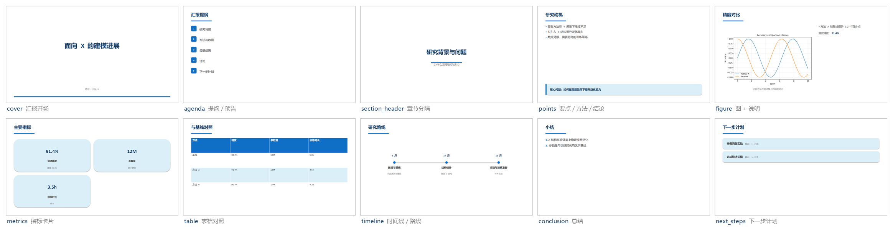

# Group-meeting-ppt


**把一次组会汇报的素材，确定性转成可编辑的 16:9 PowerPoint。**
内容与结构写在 `brief.yaml`，模板决定配色、字体与页面尺寸，脚本负责校验与渲染——内容只写一次，排版交给脚本，生成的页面全是可以继续手改的文本框与形状。

既可作为支持 `SKILL.md` 的本地 Agent Skill 使用，也可直接用 Python 运行。

**快速导航：** [效果预览](#效果预览) · [功能](#功能) · [工作流程](#工作流程) · [内置版式](#内置版式) · [快速开始](#快速开始) · [目录结构](#目录结构) · [历史版本与单页重建](#历史版本与单页重建) · [测试](#测试) · [使用注意](#使用注意)

## 效果预览

下图由 `assets/demo_brief.yaml` 经 `lab` 模板实际生成后渲染（12 页 16:9），内容为演示占位数据。



工作台把 brief 编辑、模板管理、生成和历史版本预览放在同一个界面：



<details>
<summary>更多示例页（封面 / 结果图 / 指标）</summary>


</details>

## 功能

- **10 类内置版式** — 封面、目录、章节页、要点、图片、指标、表格、时间线、结论、下一步计划，字段与选择规则见 [版式库](references/layout-library.md)。
- **主题级模板** — 用 YAML 定义配色、字体和页面尺寸；内置 `default` 与 `lab`，也可用 Tkinter 向导从自己的 `.pptx` 提取主题。
- **图形工作台** — brief 编辑、大纲调整、模板管理、生成、历史版本预览与重建一体化；大纲页签可直接上移/下移/删除段落并插入 10 类版式骨架，未保存修改会提示，生成前给出页数与容量检查，支持 Ctrl+S / Ctrl+O / Ctrl+N / Ctrl+Enter / F5 快捷键。
- **单页重建** — `--slide N` 原地重绘某一页，保留其余页面（含在 PPT 里做过的视觉微调）。
- **轻量历史快照** — 保存可重建的 brief、模板、图片与内容结构预览，图片按 SHA-256 跨版本去重，源文件与模板删掉后仍可重建。
- **生成前校验与输入保护** — 字段缺失、图片不存在、表格行列不匹配等问题会在生成前报错；输出不会覆盖 brief、所选模板或引用图片，单页重建还会校验页数。

**能力边界：** 本项目使用主题级模板和内置版式，不保留外部参考 PPT 的母版，也不逐像素复刻其版式。`lab` 模板仅包含匿名化的配色、字体和页面尺寸，不包含原 PPT 文件、Logo 或真实汇报内容。

## 工作流程



- **内容只写一次**：`brief.yaml` 是唯一事实源，`.pptx` 是派生产物；内容改动一律改 brief，不从 PPT 反向解析。
- **外观与内容分离**：配色、字体与页面尺寸独立成模板 YAML，换主题只需换模板名。
- **先校验再渲染**：字段缺失、图片不存在、表格行列不匹配会在生成前报错并指出位置。
- **可选快照**：`--history-dir` 会把 brief、模板、图片与结构预览留档，源文件删除后仍可重建。

## 内置版式



字段与推荐规则见 [版式库](references/layout-library.md)，给内容选版式时按以下顺序判断：

1. 含图片 / 曲线 / 示意图 → `figure`
2. 成组数字指标或精度对比 → `metrics`（行数多、需逐行对照 → `table`）
3. 含时间节点 / 路线图 → `timeline`
4. 纯文字要点 / 方法步骤 / 结论 → `points`
5. 章节切换 → `section_header`；开场 → `cover`；≥3 个章节可加 `agenda`；收尾 → `conclusion`；后续工作 → `next_steps`

排版约束：一页一个点；`points` 建议 ≤ 6 条；`figure` 每页一张主图；标题建议 ≤ 20 字；目录、时间线、下一步计划最多 12 项，超出请拆页。

## 快速开始

已在 **Windows + Python 3.13.9** 环境验证，其他 Python 版本和操作系统尚未全面测试。

```bash
python -m venv .venv
# Windows PowerShell：
.venv\Scripts\Activate.ps1
python -m pip install -r requirements.txt
```

直接依赖为 `PyYAML`、`Pillow`、`python-pptx`、`lxml`；历史预览另需 `numpy`、`matplotlib`，已一并列入 `requirements.txt`。依赖未固定最低版本，请不要把当前验证环境视为完整兼容矩阵。

从仓库根目录运行：

```bash
# 1) 先用示例 brief 跑通（推荐），再替换成自己的内容
python scripts/generate_ppt.py assets/demo_brief.yaml -o out/demo.pptx --history-dir out/history

# 2) 换主题：内置 lab，或先用向导从自己的 PPTX 提取主题
python scripts/generate_ppt.py assets/demo_brief.yaml -o out/demo-lab.pptx --template lab

# 3) 图形入口：工作台（推荐）与模板向导
python scripts/workbench.py
python scripts/template_wizard.py
```

一个最小的 `brief.yaml` 长这样（字段规范见 [SKILL.md](SKILL.md)）：

```yaml
meta:
  title: 组会汇报
sections:
  - type: cover
    title: 课题进展汇报
    presenter: 姓名
    date: 2026-11
  - type: points
    heading: 本阶段工作
    points:
      - 完成数据预处理与基线复现
      - 方法 A 在验证集上提升 2.1%
  - type: figure
    heading: 主要结果
    image: assets/demo_figure.png
    caption: 方法 A 与基线的对比曲线
```

`assets/demo_brief.yaml` 中的姓名和实验数值均为演示占位内容。GUI 需要 Tkinter；工作台的“打开输出”目前依赖 Windows，其他平台还需自行处理 Tkinter 与中文字体。默认引用微软雅黑、Calibri，**字体并未随仓库分发**，缺失时请调整模板字体。作为本地技能使用时，把整个目录复制到客户端的技能扫描目录即可，具体位置与发现方式以客户端文档为准。

## 目录结构

```text
group-meeting-ppt/
├─ SKILL.md                     Agent Skill 使用规范与工作流
├─ scripts/
│  ├─ generate_ppt.py           校验 / 渲染 / 单页重建 / 历史快照
│  ├─ workbench.py              Tkinter 工作台（推荐入口）
│  ├─ workbench_logic.py        工作台纯逻辑：大纲解析 / 版式骨架 / 段落增删移 / 容量提醒
│  └─ template_wizard.py        从 .pptx 提取主题的模板向导
├─ templates/                   主题档案（default、lab）
├─ references/layout-library.md 10 类版式的字段与选择规则
├─ assets/                      示例 brief 与演示配图
├─ tests/test_history.py        历史与版式回归测试
└─ docs/assets/                 README 效果图
```

## 历史版本与单页重建

开启 `--history-dir` 后，每次运行都会写入历史目录：

```text
history/
  versions/<id>/
    brief.yaml
    template.yaml
    manifest.json
  previews/<id>/preview.png
  assets/<SHA-256>
  .last_generated.json
```

- `assets/` 跨版本共享，备份或移动历史时请保留完整历史目录。
- 快照预览只展示内容结构，不是逐像素 PPT 预览。
- 快照会记录当时的模板与图片哈希，损坏或被替换时拒绝重建。
- 旧的扁平 `versions/<id>.yaml` 仍可浏览，但当时未归档图片和模板，不能保证脱离原文件重建。

从历史版本全量重建（默认使用该版本归档的模板，只有显式指定 `--template` 才覆盖它；仅指定 `--template-dir` 不会改变这一默认）：

```bash
python scripts/generate_ppt.py out/history/versions/<id>/brief.yaml -o out/restored.pptx
```

只改某一节时做单页重建：

```bash
python scripts/generate_ppt.py brief.yaml -o out/demo.pptx --slide 2
```

单页操作会保留其他页面，但会把历史状态标记为需要后续全量重建。它仅适用于由同一 brief 生成、页数和页序未发生外部调整的 PPT；页数不一致时拒绝操作，页序仍需自行核对。

## 测试

```bash
python -m unittest discover -s tests -v
```

共 57 个用例，覆盖完整历史重建、图片去重、模板与图片变化、失败回滚、输出哈希校验、单页后全量、归档损坏、旧格式兼容与 10 类版式，另含输入保护（拒绝覆盖 brief / 模板 / 引用图片）、版式容量、工作台模板路径安全、未保存确认流程，以及大纲解析、段落上移下移删除、版式骨架可生成校验。测试输入和输出均位于临时目录，不读取真实组会历史。

## 使用注意

- **内容只改 brief：** `brief.yaml` 是内容与结构的唯一事实源，`.pptx` 是派生产物，不从 PPT 反向解析内容。
- **输出覆盖：** `-o` 指向的已有输出文件会被覆盖；程序拒绝覆盖当前 brief、所选模板或引用图片，但仍建议使用独立的 `.pptx` 输出路径。
- **版式容量：** 目录、时间线和下一步计划每页最多 12 项，更多内容请拆页；长文字仍可能超出文本框，请打开 PPT 检查。
- **单页旧图：** 当前实现尚未完整清理被替换图片的 PPTX 内部 relationship。需要彻底删除敏感旧图时，请全量生成到一个新的输出文件。
- **编辑保存：** 工作台会跟踪未保存修改（标题栏显示 ●），打开其他 brief、新建或关闭窗口前会询问是否保存；仍建议随手 Ctrl+S。
- **本地隐私：** 生成过程在本机进行；工作台会将最近文件、输出和历史目录的绝对路径保存到用户目录下的 `.bohrium/ppt-workbench.json`，历史目录还会保存 brief 副本。清理本地文件或分享目录前请检查科研内容。
- **串行生成：** 同一输出文件和历史目录应串行生成，不支持多进程同时写入。
- **主题提取：** 从参考 PPT 提取主题是基础能力，复杂 Office 主题可能需要手动校正颜色与字体。

## 致谢

- 感谢**玻尔（Bohrium）**提供模型 API Token 与网关支持，本项目的脚本调试、文档撰写与测试验证借助其模型服务完成。
- 感谢 [python-pptx](https://python-pptx.readthedocs.io/)、[PyYAML](https://pyyaml.org/)、[Pillow](https://python-pillow.org/)、[lxml](https://lxml.de/)、[NumPy](https://numpy.org/)、[Matplotlib](https://matplotlib.org/) 等开源项目。
- 仓库不包含任何 Token 或凭据，请在本机自行配置密钥；请勿把密钥写入 `brief.yaml` 或提交到历史目录。

## 许可证

采用仓库创建时选择的 [MIT License](LICENSE)。字体等第三方资源不随仓库分发，不在该许可证的授权范围内。
