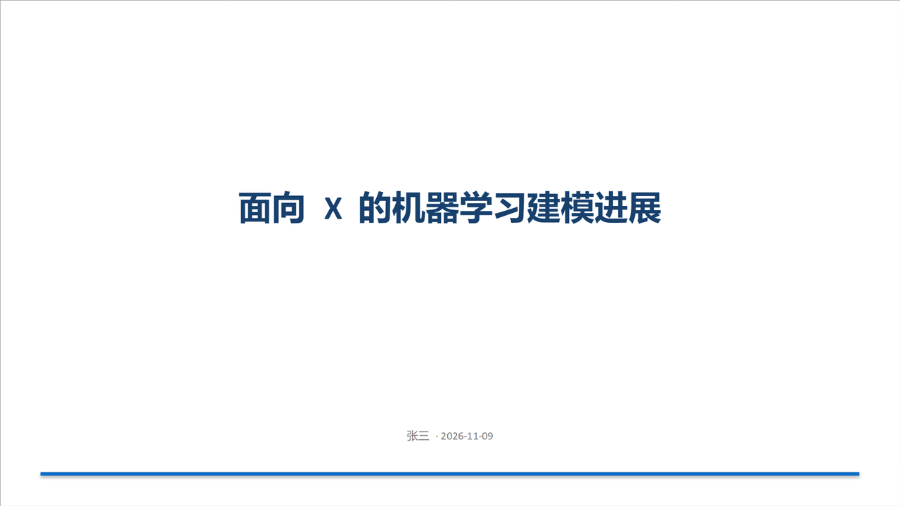
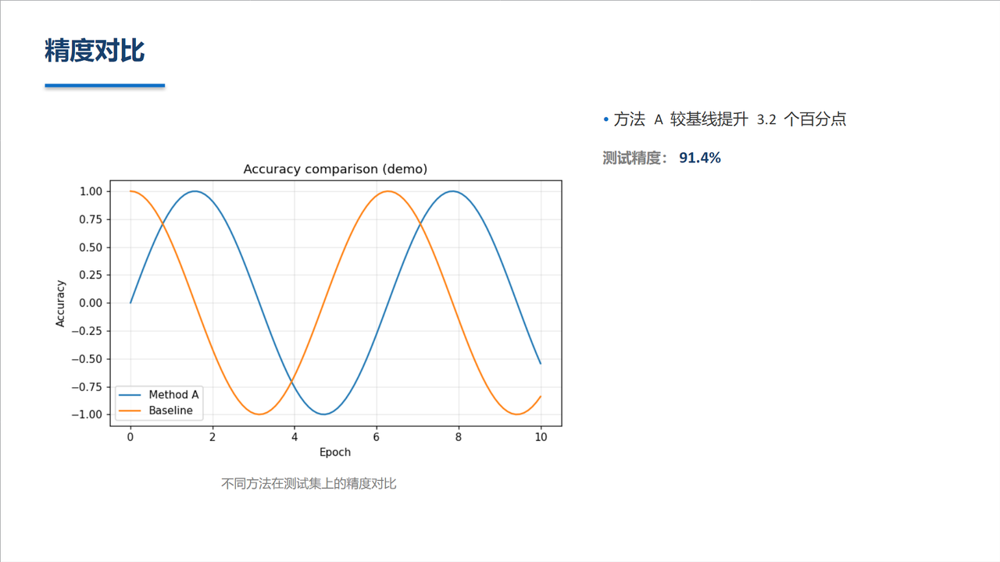
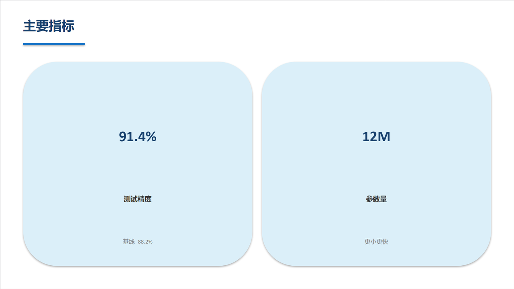

# Group-meeting-ppt

将科研组会素材整理为**可编辑的 16:9 PowerPoint**。内容与结构由 `brief.yaml` 管理，模板决定配色、字体和页面尺寸，脚本负责校验与渲染。既可作为支持 `SKILL.md` 的本地 Agent Skill，也可直接用 Python 运行。

## 功能

- 内置封面、目录、章节页、要点、图片、指标、表格、时间线、结论、下一步计划等 [10 类版式](references/layout-library.md)。
- 通过 YAML 自定义主题；可用 Tkinter 向导从 PPTX 提取基础主题。
- 图形工作台支持 brief 编辑、模板管理、生成和历史预览。
- 支持单页重建，以及保存 brief、模板、图片和轻量预览的历史版本。
- 历史图片按 SHA-256 去重，可在原始图片和模板移除后从完整历史目录重建。

**能力边界：** 本项目使用主题级模板和内置版式，不保留外部参考 PPT 的母版，也不逐像素复刻其版式。`lab` 模板仅包含匿名化的配色、字体和页面尺寸，不包含原 PPT 文件、Logo 或真实汇报内容。

## 效果预览

下图由 `assets/demo_brief.yaml` 经 `lab` 模板实际生成后渲染（12 页 16:9），内容为演示占位数据。


工作台支持 brief 编辑、模板管理、生成与历史版本预览：


<details>
<summary>更多示例页（封面 / 结果图 / 指标）</summary>







</details>

## 环境与安装

已在 **Windows + Python 3.13.9** 环境验证。其他 Python 版本和操作系统尚未全面测试。

```bash
python -m venv .venv
# Windows PowerShell：
.venv\Scripts\Activate.ps1
python -m pip install -r requirements.txt
```

直接依赖为 `PyYAML`、`Pillow`、`python-pptx`、`lxml`；历史预览另需 `numpy`、`matplotlib`，已一并列入 `requirements.txt`。依赖未固定最低版本，请不要把当前验证环境视为完整兼容矩阵。

GUI 需要 Tkinter。工作台的“打开输出”目前依赖 Windows；其他平台还需自行处理 Tkinter 与中文字体。默认引用微软雅黑、Calibri，**字体并未随仓库分发**，缺失时请调整模板字体。

作为本地技能使用时，将整个目录复制到客户端的技能扫描目录，具体位置和发现方式以客户端文档为准。

## 快速开始

从仓库根目录生成示例 PPT，并写入历史：

```bash
python scripts/generate_ppt.py assets/demo_brief.yaml -o out/demo.pptx --history-dir out/history
```

使用 `lab` 主题：

```bash
python scripts/generate_ppt.py assets/demo_brief.yaml -o out/demo-lab.pptx --template lab
```

打开工作台或模板向导：

```bash
python scripts/workbench.py
python scripts/template_wizard.py
```

`assets/demo_brief.yaml` 中的姓名和实验数值均为演示占位内容。字段规范和版式选择规则见 [SKILL.md](SKILL.md) 与 [版式库](references/layout-library.md)。

## 历史版本与单页重建

新历史目录结构：

```text
history/
  versions/<id>/
    brief.yaml
    template.yaml
    manifest.json
  previews/<id>/preview.png
  assets/<SHA-256>
  .last_generated.json
```

- `assets/` 跨版本共享，备份或移动历史时请保留完整历史目录。
- 快照预览只展示内容结构，不是逐像素 PPT 预览。
- 快照会记录当时的模板与图片哈希，损坏或被替换时拒绝重建。
- 旧的扁平 `versions/<id>.yaml` 仍可浏览，但当时未归档图片和模板，不能保证脱离原文件重建。

从历史版本全量重建：

```bash
python scripts/generate_ppt.py out/history/versions/<id>/brief.yaml -o out/restored.pptx
```

默认使用该版本的归档模板；只有显式指定 `--template` 才覆盖它。仅指定 `--template-dir` 不会改变历史模板的默认选择。

单页重建：

```bash
python scripts/generate_ppt.py brief.yaml -o out/demo.pptx --slide 2
```

单页操作会保留其他页面，但会把历史状态标为需要后续全量重建。它仅适用于由同一 brief 生成、页数和页序未发生外部调整的 PPT；页数不一致时拒绝操作，页序仍需自行核对。

## 测试

```bash
python -m unittest discover -s tests -v
```

测试覆盖完整历史重建、图片去重、模板与图片变化、失败回滚、输出哈希校验、单页后全量、归档损坏、旧格式兼容以及 10 类版式。测试输入和输出均位于临时目录，不读取真实组会历史。

## 使用注意

- **输出覆盖：** `-o` 指向的已有输出文件会被覆盖；程序拒绝覆盖当前 brief、所选模板或引用图片。
- **版式容量：** 目录、时间线和下一步计划每页最多 12 项，更多内容请拆页；长文字仍可能超出文本框，请打开 PPT 检查。
- **单页旧图：** 当前实现尚未完整清理被替换图片的 PPTX 内部 relationship。需要彻底删除敏感旧图时，请全量生成到一个新的输出文件。
- **编辑保存：** 工作台尚未实现未保存内容提醒。打开其他 brief 或关闭窗口前，请先手动保存。
- **本地隐私：** 生成过程在本机进行；工作台会将最近文件、输出和历史目录的绝对路径保存到用户目录下的 `.bohrium/ppt-workbench.json`，历史目录还会保存 brief 副本。清理本地文件或分享目录前请检查科研内容。
- 同一输出文件和历史目录应串行生成，不支持多进程同时写入。
- 参考 PPT 主题提取是基础能力，复杂 Office 主题可能需要手动校正颜色与字体。

## 致谢

- 感谢**玻尔（Bohrium）**提供模型 API Token 与网关支持，本项目的脚本调试、文档撰写与测试验证借助其模型服务完成。
- 感谢 [python-pptx](https://python-pptx.readthedocs.io/)、[PyYAML](https://pyyaml.org/)、[Pillow](https://python-pillow.org/)、[lxml](https://lxml.de/)、[NumPy](https://numpy.org/)、[Matplotlib](https://matplotlib.org/) 等开源项目。
- 仓库不包含任何 Token 或凭据，请在本机自行配置密钥；请勿把密钥写入 `brief.yaml` 或提交到历史目录。

## 许可证

采用仓库创建时选择的 [MIT License](LICENSE)。字体等第三方资源不随仓库分发，不在该许可证的授权范围内。

